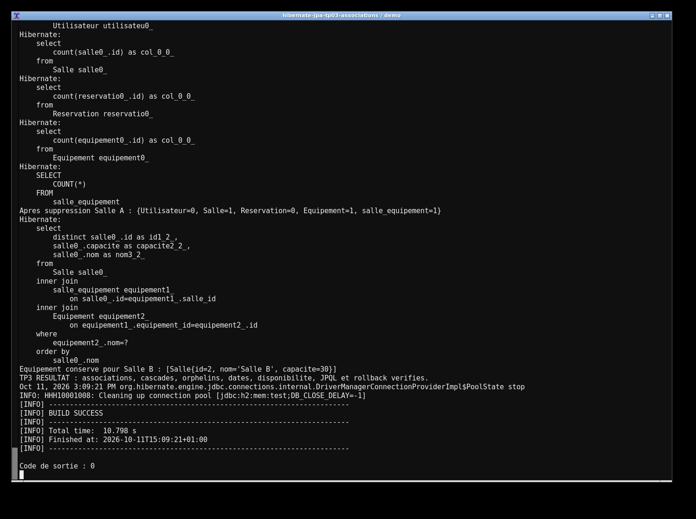
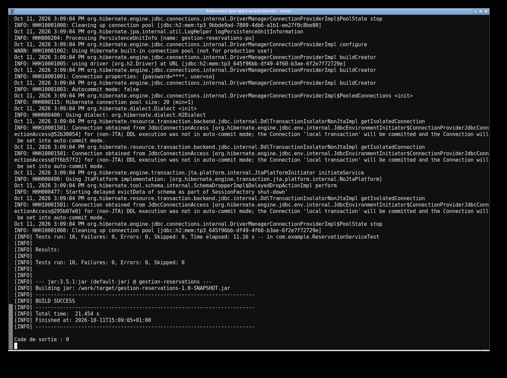

# TP 3 — Associations JPA, cascades et réservations

Dans ce TP, j'ai relié les entités Salle, Reservation, Utilisateur et Equipement avec JPA et Hibernate. J'ai utilisé les relations OneToMany, ManyToOne et ManyToMany, avec des méthodes qui gardent les deux côtés des associations à jour.

La démo crée une réservation avec sa salle et ses équipements grâce aux cascades. Elle vérifie aussi les dates, la disponibilité d'une salle et la suppression des réservations. Un équipement partagé reste en base après la suppression d'une salle.

Pour exécuter le projet, il faut Java 17 et Maven. Les données sont stockées dans une base H2 en mémoire.

```sh
mvn clean test
mvn compile exec:java
```

Les résultats enregistrés donnent **10 tests réussis, sans échec ni erreur**.

Les captures de la démo et des tests viennent d’exécutions réelles dans le terminal.




